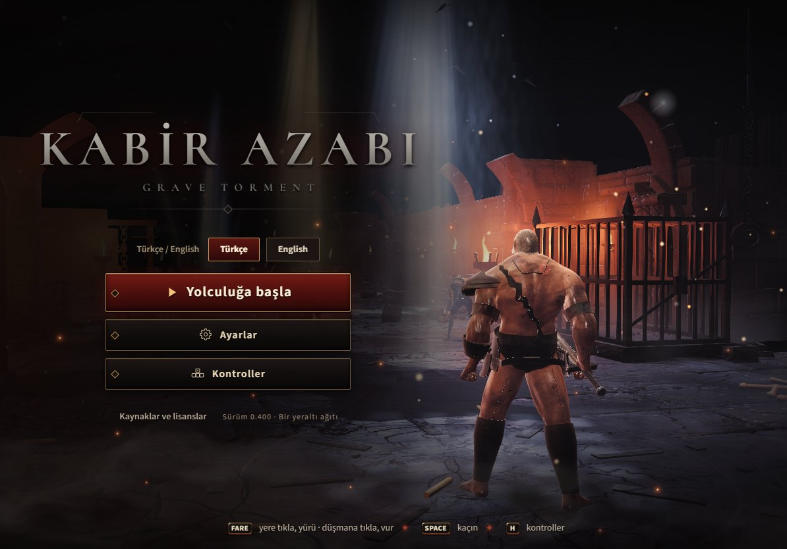
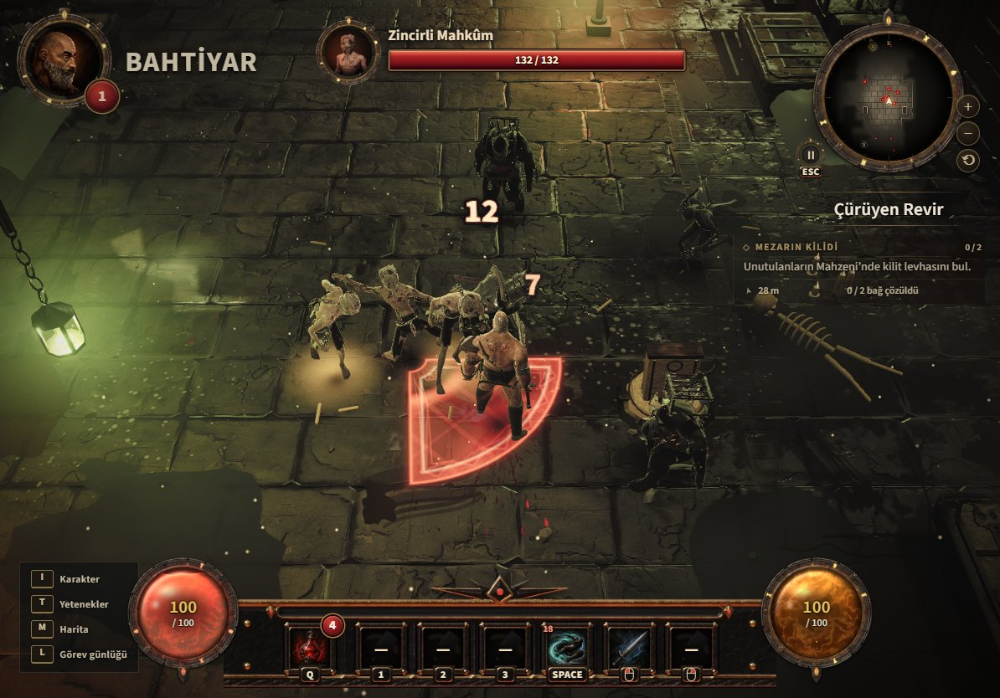
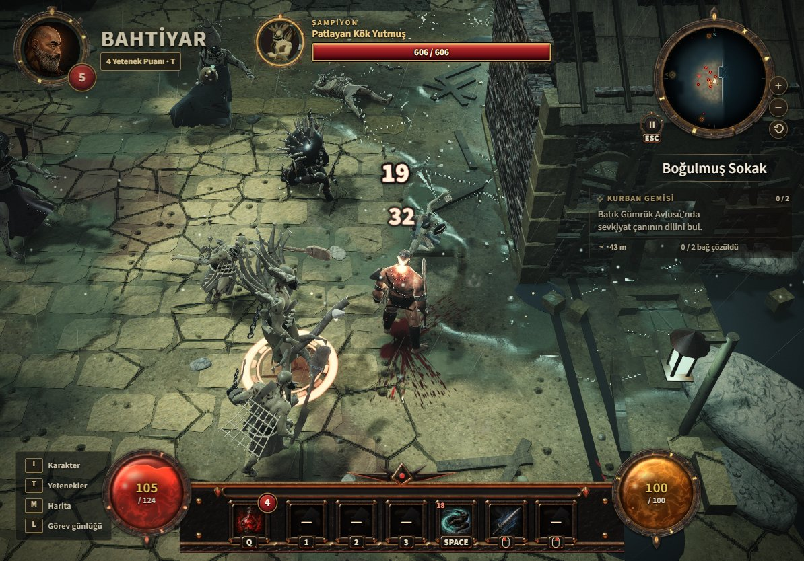
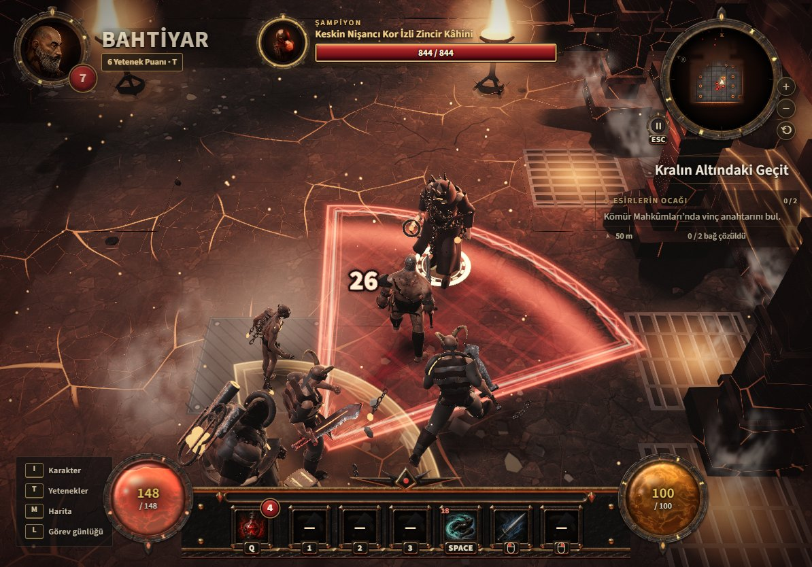
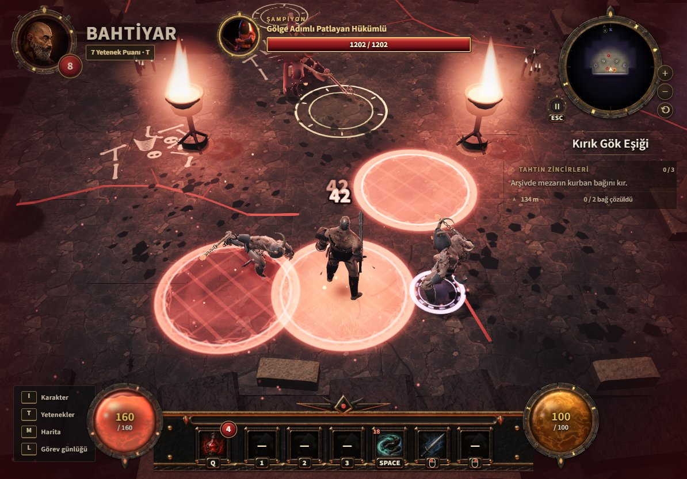
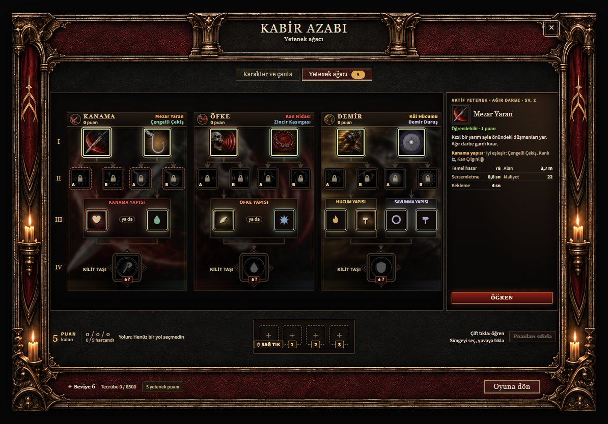

# Kabir Azabı 🗡️🔥

Canlı gömüldüğü mezardan çıkan barbar Bahtiyar’ın Kara Kadı’nın peşine düştüğü, üç boyutlu, Türkçe anlatıcı sesli bir aksiyon rol oyunu.
Beş bölüm boyunca zincirli mahkûmlarla, boğulmuş ölülerle, harabelerin bekçileriyle ve ocağın canavarlarıyla savaşırsın; her bölümün sonunda bir boss bekler.
Düşmanları keser, eşya toplar, seviye atlar, yetenek ağacından yeni güçler öğrenirsin. Fareyle oynanır; kol ve dokunmatik ekran da desteklenir.

**Yetişkinler içindir (18+). Kan, yoğun şiddet ve korku içerir.**

**Oyna:** https://goktugkarpat.github.io/bahtiyar-kabir-azabi/

## Bölümler

Her bölümde iki ana hikâye görevi, yan görevler, bir yemin taşı (kayıt noktası) ve sonda bir boss vardır. Boss kapısı iki ana görev bitince açılır.

| Bölüm | Ortam | Boss |
|---|---|---|
| I. Kurban Tapınağı | Zincirli mahkûmların, muhafızların ve ayin yapanların mahzeni | Zincir Celladı |
| II. Kara Kıyı | Yanmış mezarlık, boğulmuş sokaklar, çürük iskele ve çanlık | Derinliklerin Çancısı |
| III. Sessiz Taht | Kral harabeleri, mezarlar ve kristalli mağaralar | Kurban Bekçisi |
| IV. Kızıl Ocak | Zincirlerin dövüldüğü yeraltı ocağı | Ocağın Kalbi |
| V. Son Mahkeme | Boşluğun üstünde asılı taş platformlar, dev zincirler, Kara Defter’in arşivi | Kara Kadı |

| | |
|---|---|
|  |  |
|  |  |

İlk dört bölümün sonunda oyun sonraki bölümü kendiliğinden yükler; karakterin, çantan ve yeteneklerin taşınır. Beşinci bölümden sonra yolculuk biter ve **Yeni yolculuk** başlatılabilir.

## Nasıl açılır

- **Bilgisayarda:** klasördeki `index.html` dosyasına çift tıkla. Kurulum gerekmez; kütüphaneler klasörün içindedir.
- **Ana Ekrana Ekle:** Safari'de Paylaş → Ana Ekrana Ekle. İlk yüklemeden sonra internetsiz de açılır. Oyun asıl olarak fare ve klavyeli bilgisayar için yapılmıştır.
- **Sessiz açma:** adresin sonuna `?sessiz` ekle.
- **Dil:** başlık ekranındaki **Türkçe / English** düğmeleri (İngilizce adı *Grave Torment*).

## Nasıl oynanır

Ana ekranda **Yolculuğa başla** (kayıt varsa **Yolculuğa devam**) düğmesine bas.

| Kontrol | Ne yapar |
|---|---|
| Sol fare tuşu | Yere tıkla: yürü. Düşmana tıkla: yürü ve vur (basılı tut: vurmaya devam) |
| Shift + fare | Yürümeden fareye doğru vur |
| Sağ fare tuşu, 1, 2, 3 | Dört yetenek yuvası |
| Space | Kaçınma (yuvarlanma) |
| Q | Şifa matarası |
| E | Yemin taşına ve görev nesnelerine dokun |
| I / T | Karakter ve çanta / Yetenek ağacı |
| M / L | Harita / Görev günlüğü |
| O / H / Esc | Ayarlar / Kontroller / Mola |

- **Xbox kolu**, **dokunmatik ekran** ve isteğe bağlı **sadece klavye** (WASD) ile de oynanır; tuşlar Ayarlar › Kontroller'den değiştirilebilir.
- Düşmanlar vurmadan önce yerde uyarı işareti gösterir: **altın kenar** sıradan, **kızıl kenar** ağır darbedir. Ağır darbeden kaçmalısın.
- **Yemin taşına** dokununca can ve matara dolar, kayıt noktası olur. Ölünce son yemin taşından devam edersin; eşyan, seviyen ve yeteneklerin korunur.
- Yan görevler isteğe bağlıdır ama ödül verir: ad avı, zincirli sandık, mahkûm kurtarma, Kadı’nın Kayıtları, gizli Kan Bedeli sunağı ve daha fazlası.

### Karakter, çanta ve yetenek ağacı

- En yüksek seviye **9**; her seviyede 1 yetenek puanı, yan görevlerden de en çok 5 puan daha gelir.
- Yetenek ağacı üç daldan (**Kanama, Öfke, Demir**), dört sıradan ve 29 düğümden oluşur. Puanlar savaş dışında ücretsiz geri alınabilir.
- Beş donanım yuvası vardır (silah, başlık, göğüs, eldiven, çizme). Nadirlik: Sıradan, Sıradışı, Nadir, Epik, Eşsiz; eşsiz eşyalar boss'lardan düşer.

## Notlar

- İlerleme ve ayarlar kullandığın tarayıcıda saklanır; başka tarayıcıya ya da bilgisayara kendiliğinden taşınmaz.
- Zorluk **Kolay / Normal / Zor**; grafik kalitesi **Düşük / Orta / Yüksek**. Ses, müzik, konuşma ve altyazı ayrı ayrı ayarlanır.
- **Anlatıcı:** erkek sesi (`tr-TR-AhmetNeural`), önceden kaydedilip oyuna gömülmüştür; internetsiz de çalışır. İngilizce sürümün sesleri de gömülüdür.
- **Müzik** oyunun içinde üretilir. GitHub'a göndermek için klasördeki `yayinla.command` dosyasına çift tıkla.

## Kaynaklar ve lisanslar

- **three.js** (MIT) oyunla birlikte gelir; kenar yumuşatma kodu **SMAA** (MIT) kaynaklıdır.
- **Karakterler:** thecubber (OpenGameArt), CC BY 3.0; sakal ve bıyık RehmanPolanski, CC0; ek karakter ve hareketler Quaternius, CC0.
- **Yüzey kaplamaları:** Poly Haven, CC0.
- **Ses efektleri:** OpenGameArt ve Kenney gibi sanatçıların CC0 paketleri.
- **Yazı tipleri:** Source Sans 3 ve Cinzel, SIL OFL 1.1.

Ayrıntılar ve bağlantılar: [credits.html](credits.html) ve [ASSET-LICENSES.md](ASSET-LICENSES.md).

## Yapım

Bu oyun, **Göktuğ Karpat** (@goktugkarpat) ile yapay zekâ yardımcıları **Claude Code** (Anthropic), **Codex** (OpenAI) ve **Antigravity** (Google) birlikte çalışarak yapılmıştır.
Fikirler, hikâye ve kararlar Göktuğ Karpat'ındır; kod, sahneler ve düzenlemeler bu yardımcılarla birlikte yazılmıştır.
Kâr amacı olmadan yapılmış kişisel bir projedir.
